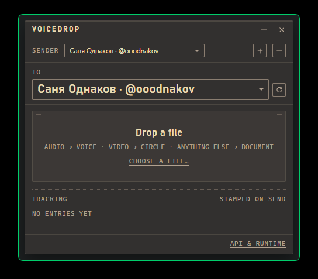

[**Русская версия →**](README.ru.md)

# VoiceDrop

[](https://github.com/ooodnakov/voice-drop/actions/workflows/ci.yml)
[](https://github.com/ooodnakov/voice-drop/actions/workflows/release.yml)
[](https://github.com/ooodnakov/voice-drop/releases/latest)


A small desktop window that behaves like one printed consignment label: drop a
file on it and it lands in Telegram as a voice note, a round video note or a
document. Portable folder, your own account, nothing in between.



## Get `api_id` / `api_hash` first

VoiceDrop uses **your own** Telegram app credentials — no keys ship with the
binary. Creating them is free and takes a minute:
**[step-by-step guide →](docs/API-KEYS.md)**.

The app opens the settings panel on first launch and links to that guide, so you
cannot get stuck at a login prompt without knowing what to paste.

## Install

| platform | files |
|---|---|
| Windows | `…x64_en-US.msi`, `…x64-setup.exe` (NSIS), `VoiceDrop-windows-x64.zip` |
| macOS | `…universal.dmg`, `VoiceDrop-macos-universal.tar.gz` |
| Linux | `…amd64.deb`, `…amd64.AppImage`, `VoiceDrop-linux-x64.tar.gz` |

The archives are plain binary folders (`bin/voice-drop` + `bin/uv` + README) —
unpack anywhere and run. Builds are unsigned: on macOS right-click → **Open** the
first time (or `xattr -dr com.apple.quarantine /Applications/VoiceDrop.app`), on
Windows expect a SmartScreen prompt.

## Requirements

- `ffmpeg` — only for conversion: non-Opus audio and videos. Opus voice files
  and plain documents send without it. The Linux `.deb` pulls it in; otherwise
  install it or drop the binary next to the app.
- Python 3.10+ **or** `uv` — the first launch provisions `runtime/python`
  (`uv venv` + `uv pip install telethon`, or `python -m venv` + pip). The binary
  archives ship `uv`, the installers rely on your system `uv`/python.

## First run

1. Paste `api_id` / `api_hash` in the **API & runtime** panel (it opens by
   itself) and press **Save**. This panel also runs checks for python, the
   Telegram session and ffmpeg.
2. Sign in: phone → code → 2FA password if the account has one. The session is
   written to `data/accounts/<digits>.session`.
3. Pick the recipient in the `to` listbox (formatted, searchable, keyboard
   driven) and drop a file.

Nothing is imported from the system: the app reads only its own
`data/config.json`, so a copied folder or a fresh download never inherits another
install's account, credentials or python path.

## Using it

- **Audio** → voice note (ffmpeg transcodes to 48 kHz mono Opus).
- **Video** → round video note (square-cropped 480×480, H.264 baseline + AAC,
  trimmed to 59 s).
- **Anything else** → a document.
- The mapping is fixed — audio is always a voice note, video always a circle,
  everything else a document — and a batch freezes its account and recipient
  when the files are dropped, so switching later does not retarget the queue.
- The window is frameless: the printed title strip is the drag handle, the drawn
  `–` / `×` minimise and close it. Layout adapts from 340×260 upwards.
- `⚙ → Theme`: `gruvbox-dark` (default), `gruvbox-light`, `paper`, `slate`, and
  `system` (follows the OS light/dark preference).
- The ledger at the bottom prints one line per send with its destination:
  `voice · #id`, `circle · #id`, `document · #id`, or the failure reason, plus
  a `retry failed` link that re-queues only what failed, for the original
  account and recipient.

## Portable layout

```
VoiceDrop/
  voice-drop[.exe]
  uv[.exe]              (ships with the archives; builds the runtime)
  ffmpeg[.exe]          (optional: bundled ffmpeg instead of PATH)
  data/config.json      (created on first run)
  data/accounts/*.session
  data/instance.lock
  runtime/python/       (auto-created venv with telethon)
```

Copy the folder to another machine and it keeps working. When the folder is not
writable — macOS `.app` in `/Applications`, Linux AppImage mount — `data/` and
`runtime/` fall back to the per-user data directory (`%APPDATA%\VoiceDrop`,
`~/Library/Application Support/VoiceDrop`, `$XDG_DATA_HOME/voicedrop`).

## Build

```
npm install
npm run tauri build      # installers for the current OS
cargo build --release    # plain binary in target/release
```

`.github/workflows/release.yml` builds Windows `msi`+`nsis`, macOS `dmg`
(universal) and Linux `deb`+`AppImage` plus binary archives on a `v*` tag;
`ci.yml` builds every push.

## How it works

```
voice-drop ──▶ <tmp>/voicedrop/tg_send.py        (embedded copy of tg_send.py)
           └─▶ <app>/runtime/python/… python tg_send.py --session … --chat …
```

`tg_send.py` drives Telethon: audio is transcoded through ffmpeg to 48 kHz mono
Opus (`-application voip`) and sent with `voice_note=True`; videos become square
MP4s sent with `video_note=True`; other files go as documents. Concurrent
processes are serialised through a lock file in the temp directory and
retried on `database is locked`. A second app instance exits immediately.

## CLI modes

```
voice-drop --oneshot <chat> <result.json> <file> [file...]

python tg_send.py --session <path> --api-id N --api-hash H --list-targets
python tg_send.py --session <path> --api-id N --api-hash H --whoami
python tg_send.py --session <path> --api-id N --api-hash H --login-send-code +380...
```
