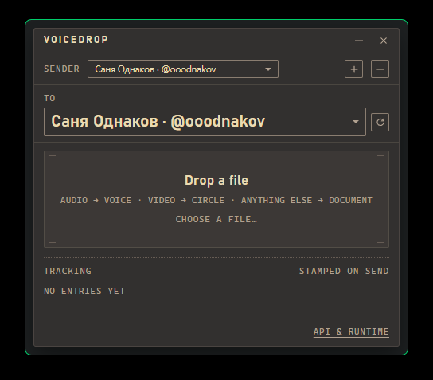

[**English version →**](README.md)

# VoiceDrop

[](https://github.com/ooodnakov/voice-drop/actions/workflows/ci.yml)
[](https://github.com/ooodnakov/voice-drop/actions/workflows/release.yml)
[](https://github.com/ooodnakov/voice-drop/releases/latest)


Маленькое окно, которое ведёт себя как одна напечатанная накладная: бросаешь на
него файл — он уходит в Telegram голосовым, кружочком или документом. Папка
portable, аккаунт свой, посредников нет.



## Сначала получи `api_id` / `api_hash`

VoiceDrop работает через **твои собственные** ключи приложения Telegram — в
сборке никаких ключей нет. Делаются бесплатно за минуту:
**[пошаговая инструкция →](docs/API-KEYS.ru.md)**.

На чистой установке приложение само открывает панель настроек и даёт ссылку на
этот гайд, так что упереться в окно входа без объяснений невозможно.

## Установка

| платформа | файлы |
|---|---|
| Windows | `…x64_en-US.msi`, `…x64-setup.exe` (NSIS), `VoiceDrop-windows-x64.zip` |
| macOS | `…universal.dmg`, `VoiceDrop-macos-universal.tar.gz` |
| Linux | `…amd64.deb`, `…amd64.AppImage`, `VoiceDrop-linux-x64.tar.gz` |

Архивы — это плоские папки с бинарями (`voice-drop` + `uv` + `README.md`):
распаковал куда угодно и запустил. Сборки не подписаны: на macOS первый раз
открывай через правый клик → **Open** (или
`xattr -dr com.apple.quarantine /Applications/VoiceDrop.app`), на Windows будет
предупреждение SmartScreen.

## Требования

- `ffmpeg` — только для конвертации: не-Opus аудио и видео. Opus и обычные
  документы уходят без него. В `.deb` он притягивается зависимостью;
  в остальных случаях поставь в систему или положи бинарь в `bin/`.
- Python 3.10+ **или** `uv` — при первом запуске создаётся `runtime/python`
  (`uv venv` + `uv pip install telethon`, либо `python -m venv` + pip). В
  архивах `uv` уже лежит, установщики используют системный `uv`/python.

## Первый запуск

1. Вставь `api_id` / `api_hash` в панель **API & runtime** (она открывается
   сама) и нажми **Save**. Там же есть кнопка проверки python, сессии Telegram
   и ffmpeg.
2. Вход: номер → код → пароль 2FA, если включён. Сессия сохраняется в
   `data/accounts/<цифры>.session`.
3. Выбери получателя в списке `to` (с форматированием, поиском и управлением с
   клавиатуры) и брось файл.

Из системы ничего не подхватывается: приложение читает только свой
`data/config.json`, поэтому скопированная папка или свежескачанный архив не
наследует чужой аккаунт, ключи или путь к python.

## Как пользоваться

- **Аудио** → голосовое (ffmpeg перекодирует в Opus 48 кГц, моно; готовый
  Opus отправляется как есть).
- **Видео** → кружочек (кроп в квадрат 480×480, H.264 baseline + AAC, до 59 с).
- **Всё остальное** → документ.
- Правило фиксированное — аудио всегда голосовым, видео всегда кружком,
  остальное документом. Пакет запоминает аккаунт и получателя в момент броска
  файлов: переключение после этого не меняет маршрут очереди.
- Окно без системной рамки: полоса с названием — это ручка перетаскивания,
  нарисованные `–` / `×` сворачивают и закрывают. Раскладка подстраивается от
  340×260 и больше.
- `⚙ → Theme`: `gruvbox-dark` (по умолчанию), `gruvbox-light`, `paper`, `slate`
  и `system` (следует за светлой/тёмной темой ОС).
- Журнал внизу печатает строку на каждую отправку с получателем:
  `voice · #id`, `circle · #id`, `document · #id` или причину ошибки, плюс
  ссылку `retry failed` — она ставит в очередь только неудачные файлы для их
  исходных аккаунта и получателя.

## Portable-раскладка

```
VoiceDrop/
  voice-drop[.exe]
  uv[.exe]              (едет в архивах; собирает runtime)
  ffmpeg[.exe]          (опционально: ffmpeg рядом вместо PATH)
  data/config.json      (создаётся при первом запуске)
  data/accounts/*.session
  data/instance.lock
  runtime/python/       (venv с telethon, создаётся сам)
```

Скопировал папку на другую машину — всё продолжает работать. Если папка
недоступна для записи — macOS `.app` в `/Applications`, AppImage-моунт — `data/`
и `runtime/` уезжают в пользовательскую папку данных (`%APPDATA%\VoiceDrop`,
`~/Library/Application Support/VoiceDrop`, `$XDG_DATA_HOME/voicedrop`).

## Сборка

```
npm install
npm run tauri build      # установщики для текущей ОС
cargo build --release    # обычный бинарь в target/release
```

`.github/workflows/release.yml` по тегу `v*` собирает Windows `msi`+`nsis`,
macOS `dmg` (universal), Linux `deb`+`AppImage` и архивы бинарей; `ci.yml`
собирает каждый push.

## Как это устроено

```
voice-drop ──▶ <tmp>/voicedrop/tg_send.py        (встроенная копия tg_send.py)
           └─▶ <app>/runtime/python/… python tg_send.py --session … --chat …
```

`tg_send.py` работает через Telethon: аудио перекодируется ffmpeg в Opus 48 кГц
моно (`-application voip`) и уходит с `voice_note=True`; видео превращается в
квадратный MP4 и уходит с `video_note=True`; остальное — документами.
Параллельные процессы сериализуются через `<session>.lock` рядом с сессией и
повторяются при `database is locked`.
Второй экземпляр приложения сразу завершается.

## CLI

```
voice-drop --oneshot <chat> <result.json> <file> [file...]
voice-drop --doctor            # где найдены python/ffmpeg/uv, и выход

python tg_send.py --session <path> --api-id N --api-hash H --list-targets
python tg_send.py --session <path> --api-id N --api-hash H --whoami
python tg_send.py --session <path> --api-id N --api-hash H --login-send-code +380...
```
